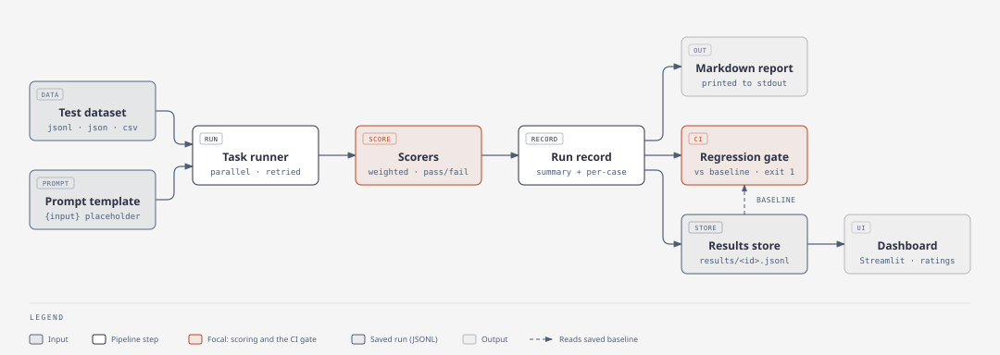
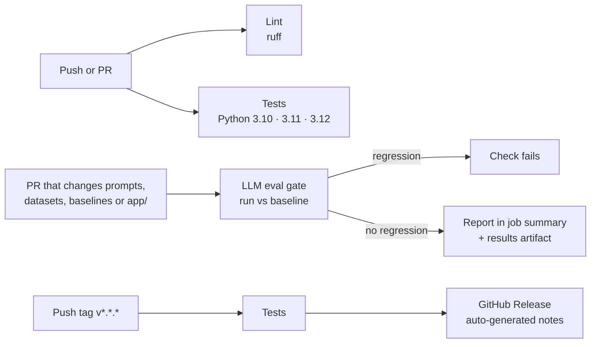

<h1 align="center">LLM Eval Framework</h1>

<p align="center">
  <strong>Measure LLM changes with data, so you don't have to judge them by feel.</strong>
</p>

<p align="center">
  <a href="https://github.com/masudibnmusa/Evaluation-Benchmarking-Framework/actions/workflows/ci.yml"></a>
  <a href="#quick-start"></a>
  <a href="#license"></a>
  <a href="#testing"></a>
  <a href="https://github.com/masudibnmusa/Evaluation-Benchmarking-Framework/commits/main"></a>
</p>

<p align="center">
  <a href="#configuration"></a>
  <a href="#dashboard-and-human-review"></a>
  
  
  <a href="#regression-tracking-and-the-ci-gate"></a>
</p>

This toolkit runs a set of test cases through an LLM, scores the answers in several ways, saves every run, and tells you whether a new prompt or model is better, worse, or just noise. It can also fail a CI build when quality drops.

> "I tweaked the prompt and it feels better" → "I tweaked the prompt, mean score went from 0.71 to 0.78, and the 95% confidence interval excludes zero."

---

## Contents

- [Highlights](#highlights)
- [How it works](#how-it-works)
- [Quick start](#quick-start)
- [Datasets](#datasets)
- [Prompts](#prompts)
- [Scorers](#scorers)
- [CLI reference](#cli-reference)
- [Comparing models and prompts](#comparing-models-and-prompts)
- [Regression tracking and the CI gate](#regression-tracking-and-the-ci-gate)
- [CI/CD](#cicd)
- [Dashboard and human review](#dashboard-and-human-review)
- [Using it from Python](#using-it-from-python)
- [Configuration](#configuration)
- [Project structure](#project-structure)
- [Design decisions](#design-decisions)
- [Testing](#testing)
- [Limitations and roadmap](#limitations-and-roadmap)

---

## Highlights

| Area | What's included |
|---|---|
| **Scoring** | Exact match, fuzzy match, JSON-schema / regex / length checks, embedding similarity, and LLM-as-judge with a rubric. Weighted combinations of any of these. |
| **Statistics** | Paired bootstrap test (5,000 resamples) with 95% confidence intervals, so small differences aren't mistaken for real improvements. |
| **Regression gating** | Compares a run to a saved baseline using tolerances, not single-case flips, and exits non-zero for CI. |
| **Reproducibility** | Every run records the model, parameters, full prompt template, scorer weights, and a hash of the dataset. |
| **Reliability** | Parallel execution, optional rate limiting, exponential backoff with jitter on 429/5xx/timeouts. A failed API call is recorded as an error and does not stop the run. |
| **Human evaluation** | A Streamlit rating UI plus Cohen's kappa (plain and quadratic-weighted) to measure agreement between raters. |
| **Reporting** | Markdown CLI report, per-category / per-difficulty breakdowns, failure grouping, and a Streamlit dashboard with trends over time. |

**Tech stack:** Python 3.10+, Anthropic SDK, pandas, NumPy, RapidFuzz, jsonschema, Streamlit, pytest. sentence-transformers is optional.

---

## How it works

<picture>
  <source media="(prefers-color-scheme: dark)" srcset="docs/how-it-works-dark.svg">
  
</picture>

| Step | Module | What happens |
|---|---|---|
| Task runner | [`runners/task_runner.py`](app/runners/task_runner.py) | Calls the model once per case, in parallel, with rate limiting and retries. Records raw outputs, latency, and tokens. |
| Scorers | [`scorers/composite_scorer.py`](app/scorers/composite_scorer.py) | Combines the chosen scorers into one weighted score per case. A case passes at `--pass-score` or above. |
| Run record | [`pipeline.py`](app/pipeline.py) (`evaluate`, `summarize`) | Holds the run settings, the summary (mean score, pass rate, errors, category and difficulty breakdowns), and every case's output and scores |
| Report | [`reporting/report_generator.py`](app/reporting/report_generator.py) | Prints a Markdown report to stdout, even with `--no-save` |
| Regression gate | [`tracking/regression_detector.py`](app/tracking/regression_detector.py) | Runs with `--baseline` (or the `compare` command). Compares the run to a baseline loaded from `data/baselines/`. Exits with code 1 on regression. |
| Results store | [`tracking/results_store.py`](app/tracking/results_store.py) | Saves the run to `data/results/<run_id>.jsonl` (skipped with `--no-save`) and stores named baselines |
| Dashboard | [`reporting/dashboard.py`](app/reporting/dashboard.py), [`human_eval/`](app/human_eval/) | Streamlit pages that read saved runs, for browsing results and rating outputs by hand |

Generating outputs and scoring them are separate steps. Raw outputs are saved with the scores, so saved runs can be scored again without calling the model (see [Using it from Python](#using-it-from-python)).

---

## Quick start

### 1. Install

```bash
git clone https://github.com/masudibnmusa/Evaluation-Benchmarking-Framework.git
cd Evaluation-Benchmarking-Framework

python -m venv .venv
source .venv/bin/activate          # Windows: .venv\Scripts\activate
pip install -r requirements.txt

cp .env.example .env               # then set ANTHROPIC_API_KEY
```

### 2. Check the install (no API key needed)

```bash
pytest
```

### 3. Create a tiny dataset and prompt

```bash
mkdir -p data/test_sets prompts

cat > data/test_sets/my_task.jsonl <<'EOF'
{"id": "add_1", "input": "What is 2 + 2?", "expected": "4", "metadata": {"category": "math", "difficulty": "easy"}}
{"id": "add_2", "input": "What is 17 + 25?", "expected": "42", "metadata": {"category": "math", "difficulty": "medium"}}
{"id": "cap_1", "input": "What is the capital of France?", "expected": "Paris", "metadata": {"category": "geography", "difficulty": "easy"}}
EOF

echo 'Answer with only the final answer, no explanation.

Question: {input}' > prompts/v1.txt
```

### 4. Run, set a baseline, check for regressions

```bash
# Evaluate. The run is saved and a Markdown report is printed.
python -m app.main run \
  --dataset data/test_sets/my_task.jsonl \
  --prompt prompts/v1.txt \
  --scorers exact_match,fuzzy_match:0.5

# Make the latest run the baseline called "my_task"
python -m app.main set-baseline --name my_task

# Later, after changing the prompt or model, run again and compare.
# Exit code 1 means a regression was found.
python -m app.main run --dataset data/test_sets/my_task.jsonl --prompt prompts/v2.txt --baseline my_task

# Browse results
streamlit run app/reporting/dashboard.py
```

The wrapper script runs step 4's first command, with settings taken from environment variables:

```bash
DATASET=data/test_sets/my_task.jsonl PROMPT=prompts/v1.txt SCORERS=exact_match ./run_eval.sh
```

### Example report

When the model answers in a full sentence, `exact_match` fails the case. `fuzzy_match` gives it partial credit, but not enough to pass:

```
# Eval report: 20261109T171217-0a729f

- Model: `claude-sonnet-4-6`
- Prompt version: `v1`
- Dataset hash: `cb6de840ceab455d`
- Scorers: exact_match (1.0), fuzzy_match (0.5)
- Cases: 3 | errors: 0

## Overall

- Mean score: **0.698**
- Pass rate: **66.7%**
- Mean latency: 0.84s
- Tokens: 96 in / 6 out

## By Category

| Group | N | Mean score | Pass rate |
|---|---|---|---|
| geography | 1 | 0.093 | 0.0% |
| math | 2 | 1.000 | 100.0% |

## By Difficulty
...

## Worst failures (top 1)

### cap_1 (score 0.09)
- Input: What is the capital of France?
- Expected: Paris
- Output: The capital of France is Paris.
- exact_match: expected 'Paris', got 'The capital of France is Paris.'
- fuzzy_match: similarity=0.28
```

---

## Datasets

The supported formats are **JSONL** (one case per line), **JSON** (a list of cases, or `{"cases": [...]}`), and **CSV**.

```json
{
  "id": "case_001",
  "input": "Summarize: The quick brown fox...",
  "expected": "A fox jumps over a dog.",
  "criteria": ["Mentions the fox", "Under 20 words"],
  "metadata": {"category": "summarization", "difficulty": "easy", "tags": ["short-input"]}
}
```

| Field | Required | Used by |
|---|---|---|
| `id` | yes | Unique, stable id. Runs and baselines are matched on it. |
| `input` | yes | Inserted into the prompt in place of `{input}`. |
| `expected` | no | Reference answer for exact, fuzzy, and semantic scorers, and shown to the LLM judge. Cases without it skip those three scorers. |
| `criteria` | no | Rubric for the LLM judge and the human review UI. A default rubric is used when empty. |
| `metadata` | no | `category` and `difficulty` drive the report breakdowns. `schema` is used by the schema scorer. Any other key is kept. |

Numbers in `id`, `input`, or `expected` are converted to text, so `"expected": 4` works.

**CSV** columns are `id`, `input`, `expected`, and `criteria` (separate items with `|`). Every other column becomes metadata:

```csv
id,input,expected,criteria,category,difficulty
q1,What is 2+2?,4,,math,easy
```

The loader rejects empty datasets, duplicate or empty ids, and empty inputs. You can also build datasets in code with `DatasetBuilder` ([dataset_builder.py](app/datasets/dataset_builder.py)).

> **Dataset hash.** Each run stores a hash of the full dataset. If you edit any case, the hash changes and the regression gate refuses to compare against older baselines. Pass `--allow-dataset-change` to compare anyway.

---

## Prompts

`--prompt` accepts a **file path** or **literal text**.

- `{input}` is replaced with each case's input. If the placeholder is missing, the input is added at the end.
- Other braces are left alone, so JSON examples in prompts are safe.
- The prompt version saved with the run is the file name without extension (`prompts/v2.txt` → `v2`). For literal text it is `inline-<hash>`.

---

## Scorers

Every scorer returns a score from 0 to 1. The composite scorer computes a weighted average per case, and a case **passes** when that average is at least `--pass-score` (default `0.5`).

| `--scorers` name | Best for | How it scores | Needs |
|---|---|---|---|
| `exact_match` | Classification, short answers | 1 if equal after ignoring case and collapsing whitespace, else 0 | `expected` |
| `fuzzy_match` | Near-miss strings, typos | RapidFuzz similarity ratio | `expected` |
| `schema` / `schema_validator` | Structured JSON output | Validates against `metadata.schema` (a dict or JSON string). Code fences around the JSON are accepted. | `metadata.schema` |
| `semantic` / `semantic_similarity` | Paraphrases | Cosine similarity of `all-MiniLM-L6-v2` embeddings | `expected`, `pip install sentence-transformers` |
| `llm_judge` | Open-ended writing, summaries | Judge model rates 1–5 against `criteria`, mapped to 0–1 | API key |

Weights go after a colon: `--scorers exact_match:0.3,llm_judge:0.7`. Scorers without a weight get `1.0`.

**Errors.** A case whose model call failed scores 0 and is counted in `n_errors`. If a scorer throws an exception on a case, that case gets 0 for that scorer with the reason recorded, and the run continues.

### Adding your own scorer

1. Subclass `BaseScorer` and return a `ScoreResult` through `self._result(...)`:

   ```python
   # app/scorers/keyword_scorer.py
   from app.scorers.base_scorer import BaseScorer

   class KeywordScorer(BaseScorer):
       name = "keyword"

       def score(self, case, output):
           keyword = case.metadata.get("keyword", "")
           hit = keyword.lower() in output.lower()
           return self._result(1.0 if hit else 0.0, f"keyword {keyword!r} {'found' if hit else 'missing'}")
   ```

2. Register the name in `_make_scorer` in [app/pipeline.py](app/pipeline.py) so `--scorers keyword` works.

Set `needs_expected = True` on the class if the scorer only makes sense when a case has `expected`.

### Using LLM-as-judge well

The judge runs at temperature 0 and must answer in a strict JSON format. Judges still have known biases (for example, favoring longer answers or their own model's style). To keep the scores trustworthy:

- Write specific `criteria` for each case instead of relying on the default rubric.
- Rate a sample by hand in the [human review UI](#dashboard-and-human-review) and check how often humans and the judge agree.
- Consider using a different judge model from the one under test (`--judge-model`).

---

## CLI reference

```bash
python -m app.main <command> --help
```

| Command | What it does | Exit code |
|---|---|---|
| `run` | Evaluate one model and prompt. With `--baseline`, also runs the regression check. | `1` if the regression check fails |
| `compare-models` | Same dataset and prompt across several models | `0` |
| `compare-prompts` | Same dataset and model across several prompts | `0` |
| `compare` | Compare a saved run (default `latest`) against a baseline | `1` on regression |
| `set-baseline` | Save a run (default `latest`) as a named baseline | `0` |

**Common options** (`run`, `compare-models`, `compare-prompts`):

| Option | Default | Description |
|---|---|---|
| `--dataset` | required | Path to `.jsonl`, `.json`, or `.csv` |
| `--scorers` | `exact_match` | Comma-separated list, optional `:weight` per scorer |
| `--judge-model` | `EVAL_JUDGE_MODEL` | Model used by `llm_judge` |
| `--pass-score` | `0.5` | Minimum weighted score for a case to pass |
| `--concurrency` | `8` | Parallel model calls |
| `--no-save` | off | Don't write the run to `data/results/` |

**`run` only:** `--prompt` (required), `--model`, `--temperature` (default `0.0`), `--max-tokens` (default `1024`), `--baseline`.

**Regression options** (`run`, `compare`): `--max-drop`, `--case-drop`, `--max-regressed-fraction`, `--allow-dataset-change`. See [the gate rules](#regression-tracking-and-the-ci-gate).

---

## Comparing models and prompts

```bash
# Same dataset and prompt, several models
python -m app.main compare-models \
  --dataset data/test_sets/my_task.jsonl \
  --prompt prompts/v1.txt \
  --models claude-sonnet-4-6,claude-haiku-4-5

# Same dataset and model, several prompts
python -m app.main compare-prompts \
  --dataset data/test_sets/my_task.jsonl \
  --prompts prompts/v1.txt,prompts/v2.txt
```

The output is a table with mean score, pass rate, errors, latency, and token usage for each variant. Every variant is saved as its own run. Open the dashboard for per-category breakdowns.

With **exactly two** variants, a paired bootstrap test is printed as well:

```
v2 vs v1: diff=+0.067 95% CI [+0.017, +0.117] p=0.012 (significant)
```

The difference is called significant only when the 95% confidence interval excludes zero. On small datasets, a few points of difference is often noise.

---

## Regression tracking and the CI gate

Every run is saved to `data/results/<run_id>.jsonl`. Run ids start with a UTC timestamp, so they sort in time order.

- **Line 1** holds the run metadata: model, parameters, full prompt template, scorer weights, pass score, dataset hash, and summary metrics.
- **Each following line** is one case: the input, the raw model output, latency, tokens, every scorer's score and reason, and the final score.

Baselines are copies of a run stored in `data/baselines/<name>.jsonl`. `--baseline` accepts a baseline name or a file path.

### Gate rules

The check **fails** if any of these is true:

| Rule | Option | Default |
|---|---|---|
| The dataset hash differs from the baseline's | `--allow-dataset-change` to skip this rule | on |
| The mean score dropped by more than the limit | `--max-drop` | `0.02` |
| Too many cases regressed. A case regresses when its score drops by at least `--case-drop` (default `0.3`). | `--max-regressed-fraction` | `0.1` (10%) |

Means are calculated only over case ids present in both runs. Because model output is noisy, the gate looks at the aggregate score and the share of regressed cases. One case flipping does not fail it.

### Running the gate yourself

```bash
python ci/run_eval_suite.py --dataset data/test_sets/my_task.jsonl --prompt prompts/v1.txt
python ci/gate_on_regression.py --baseline my_task --max-drop 0.02
```

These scripts are thin wrappers around `app.main run` and `app.main compare --run latest`, and they take the same options. In GitHub Actions, the [LLM eval gate workflow](#cicd) runs this for you.

---

## CI/CD

Three GitHub Actions workflows live in [`.github/workflows/`](.github/workflows/):



| Workflow | Trigger | What it does | Secrets |
|---|---|---|---|
| [**CI**](.github/workflows/ci.yml) | Every push to `main`, every PR, manual | Lints with `ruff`, runs `pytest` on Python 3.10, 3.11, and 3.12, and checks that the CLI starts | None. The tests never call an API. |
| [**LLM eval gate**](.github/workflows/eval.yml) | PRs that change `prompts/`, `data/test_sets/`, `data/baselines/`, `app/` or `requirements.txt`, or a manual run | Runs the eval suite against the committed baseline and fails if quality regressed. Adds the Markdown report to the job summary and uploads the report and run JSONL as an artifact (kept 30 days). | `ANTHROPIC_API_KEY` |
| [**Release**](.github/workflows/release.yml) | Pushing a tag like `v1.2.0` | Re-runs the tests, then publishes a GitHub Release with notes generated from the merged PRs | None (uses the built-in token) |

[Dependabot](.github/dependabot.yml) also opens weekly PRs to update Python packages and GitHub Actions. Each of those PRs goes through CI.

### Setting up the eval gate

1. Add an `ANTHROPIC_API_KEY` secret under **Settings → Secrets and variables → Actions**.
2. Commit a dataset, a prompt, and a baseline:

   ```bash
   python -m app.main run --dataset data/test_sets/my_task.jsonl --prompt prompts/v1.txt
   python -m app.main set-baseline --name my_task
   git add data/test_sets/my_task.jsonl prompts/v1.txt data/baselines/my_task.jsonl
   ```

3. Optional: change the defaults with repository **variables** instead of editing the workflow. The variables are `EVAL_DATASET`, `EVAL_PROMPT`, `EVAL_SCORERS`, `EVAL_BASELINE`, and `EVAL_MODEL`. The defaults are `data/test_sets/my_task.jsonl`, `prompts/v1.txt`, `exact_match`, `my_task`, and the default model. Manual runs (**Actions → LLM eval gate → Run workflow**) can override each value.
4. To block merges on a regression, make **Eval vs baseline** a required status check in branch protection.

If the secret is missing (for example on PRs from forks) or any of the three files is missing, the workflow skips with a notice instead of failing.

**Cost:** every run of the eval gate calls the model once per test case, plus once more per case if you use `llm_judge`. Keep CI datasets small, or narrow the `paths:` filter in `eval.yml`.

### Shipping a change

1. Open a PR. CI and the eval gate run on it.
2. If the eval gate reports an intended improvement, update the baseline in the same PR (`set-baseline`, then commit `data/baselines/`). Future PRs are then compared against the new quality level.
3. Merge, then tag a release:

   ```bash
   git tag v1.0.0 && git push origin v1.0.0
   ```

---

## Dashboard and human review

```bash
streamlit run app/reporting/dashboard.py         # browse results
streamlit run app/human_eval/review_interface.py # rate outputs by hand
```

**Dashboard tabs:**
- **Overview:** headline metrics and category and difficulty charts.
- **Failures:** failures grouped by category and scorer, plus the 15 worst cases with input, expected answer, output, and each scorer's reason.
- **Trends:** score history across runs on the same dataset hash.
- **Compare runs:** paired bootstrap test between any two runs.

**Human review:** pick a run, enter your name, and rate each output from 1 to 5 with an optional comment. Ratings are appended to `data/results/human_ratings/<run_id>.jsonl`. When two or more people have rated a run, the sidebar shows pairwise Cohen's kappa, plain and quadratic-weighted.

---

## Using it from Python

Everything the CLI does is available as functions. Any object with a `complete(prompt) -> (text, input_tokens, output_tokens, latency_s)` method can be the system under test. That can be another provider's SDK, a RAG pipeline, or a local model.

```python
from app.config import ModelConfig
from app.datasets.dataset_loader import load_dataset
from app.pipeline import build_composite, score_outputs, summarize
from app.runners.task_runner import TaskRunner


class MyPipeline:
    def complete(self, prompt: str):
        text = my_rag_system(prompt)          # your code
        return text, 0, 0, 0.0


cases = load_dataset("data/test_sets/my_task.jsonl")
outputs = TaskRunner(ModelConfig(name="my-rag-v3"), client=MyPipeline()).run(cases, "{input}")

scorer = build_composite("exact_match:0.5,fuzzy_match:0.5")
results = score_outputs(cases, outputs, scorer)
print(summarize(results))
```

Other useful entry points:

| Function | Purpose |
|---|---|
| `app.pipeline.evaluate(...)` | Generate, score, and summarize in one call; returns a `RunRecord` |
| `app.tracking.results_store.ResultsStore` | `save`, `load`, `list_runs`, `set_baseline`, `load_baseline` |
| `app.tracking.regression_detector.detect(current, baseline)` | Returns a `RegressionReport` (`.passed`, `.to_text()`) |
| `app.comparison.ab_test_analyzer.compare_runs(a, b)` | Paired bootstrap between two runs |
| `app.reporting.failure_analyzer.group_failures(run)` | Failures by category, scorer, and error type |
| `app.human_eval.inter_rater_agreement.cohens_kappa(r1, r2)` | Agreement between two raters |

To **score a saved run again** without calling the model, load it with `ResultsStore().load(run_id)` and pass `[r.case for r in run.results]` and `[r.output for r in run.results]` to `score_outputs` with a new scorer.

---

## Configuration

**Environment variables** go in `.env`:

| Variable | Default | Purpose |
|---|---|---|
| `ANTHROPIC_API_KEY` | none | Required for real model calls and `llm_judge` |
| `EVAL_DEFAULT_MODEL` | `claude-sonnet-4-6` | Default `--model` |
| `EVAL_JUDGE_MODEL` | `claude-sonnet-4-6` | Default `--judge-model` |
| `LOG_LEVEL` | `INFO` | Logs go to stderr, so the report on stdout stays clean |

**Code defaults** are in [app/config.py](app/config.py):

| Setting | Default | Notes |
|---|---|---|
| `RunnerConfig.max_retries` | `3` | Retries on 408/409/429/5xx and connection errors. 4xx client errors are not retried. |
| `RunnerConfig.timeout_s` | `60` | Timeout for each request |
| `RunnerConfig.requests_per_second` | `0` | `0` means no rate limit |
| `DEFAULT_PASS_SCORE` | `0.5` | |
| `DEFAULT_MAX_AGGREGATE_DROP` | `0.02` | |
| `DEFAULT_CASE_DROP` | `0.3` | |
| `DEFAULT_MAX_REGRESSED_FRACTION` | `0.1` | |

Data lives under `data/` (`test_sets/`, `results/`, `baselines/`). The folders are created on first use.

---

## Project structure

```
app/
├── main.py                     CLI (argparse): run, compare-models, compare-prompts, compare, set-baseline
├── pipeline.py                 generate → score → summarize; scorer registry; prompt loading
├── config.py                   env vars, paths, default thresholds, ModelConfig / RunnerConfig
├── datasets/
│   ├── schemas.py              TestCase, ModelOutput, ScoreResult, CaseResult, RunRecord
│   ├── dataset_loader.py       JSONL / JSON / CSV loading, validation, dataset hash
│   └── dataset_builder.py      build datasets in code and save as JSONL
├── runners/
│   ├── task_runner.py          LLMClient protocol, AnthropicClient, TaskRunner
│   ├── batch_executor.py       thread pool + thread-safe rate limiter (keeps input order)
│   └── retry_handler.py        exponential backoff with jitter
├── scorers/                    base, exact, fuzzy, schema, semantic, llm_judge, composite
├── comparison/                 model / prompt comparators, paired bootstrap A/B test
├── tracking/                   results store, regression detector, score history
├── reporting/                  Markdown report, failure analyzer, Streamlit dashboard
├── human_eval/                 Streamlit rating UI, Cohen's kappa
└── utils/logger.py
ci/                             run_eval_suite.py, gate_on_regression.py
.github/workflows/              ci.yml (lint + tests), eval.yml (LLM eval gate), release.yml
.github/dependabot.yml          weekly dependency and Actions updates
tests/                          pytest suite (scorers, regression detector, edge cases)
run_eval.sh                     wrapper around `app.main run` with env-var settings
ruff.toml                       lint rules used by CI
```

---

## Design decisions

1. **Generation and scoring are separate.** Raw outputs are saved, so you can change scorers or weights and score again without paying for new API calls.
2. **Every score can be traced.** Each run stores the model, temperature, max tokens, the full prompt template, scorer weights, and the dataset hash.
3. **Noise is expected.** Comparisons use a paired bootstrap, and the regression gate uses tolerances instead of reacting to single cases.
4. **Failures are recorded, not fatal.** One timeout or one buggy scorer shows up in the report instead of throwing away a whole paid run.
5. **Cheap checks run first.** A missing baseline, an unknown scorer, or a missing optional dependency is caught before any model call is made.
6. **Easy to extend.** New scorers are a subclass plus one registry line. Any system can be tested by implementing `LLMClient.complete`.

---

## Testing

```bash
pytest            # no API key needed; the tests use fake model clients
pip install ruff && ruff check .   # the same lint CI runs
```

The tests cover the scorers, composite weighting, error handling, dataset loading edge cases, the regression gate including rounding edge cases, and prompt comparison.

---

## Limitations and roadmap

- **One built-in provider.** Only Anthropic is built in. Other providers work through a custom `LLMClient` (see [Using it from Python](#using-it-from-python)).
- **Scoring is sequential.** Model calls run in parallel, but scoring runs one case at a time, which slows down `llm_judge` on large datasets.
- **Single judge sample.** The judge is called once per case. Averaging several samples would reduce noise.
- **No experiment config file.** Runs are configured with CLI flags. A YAML experiment file is a planned addition.
- **CLI gaps.** `compare-models` and `compare-prompts` use the default temperature and max tokens.
- **Local storage.** Results are JSONL files on disk; there is no database backend.

---

## License

MIT
